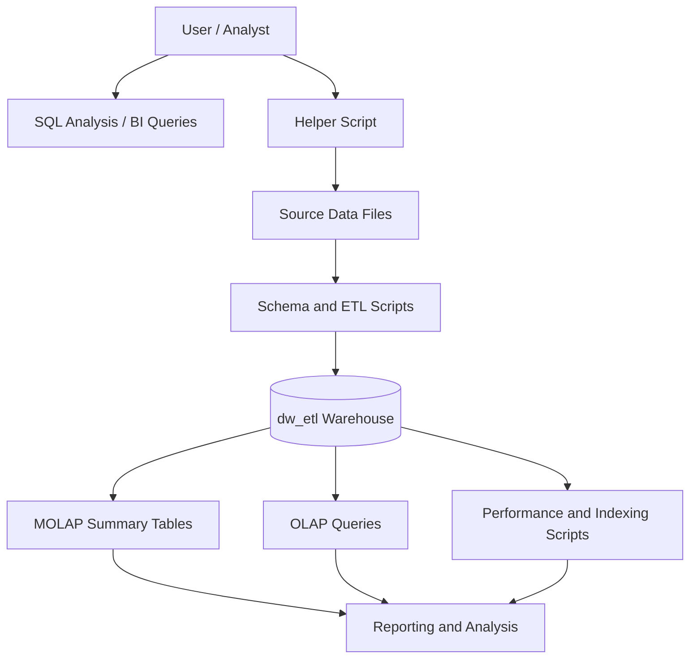
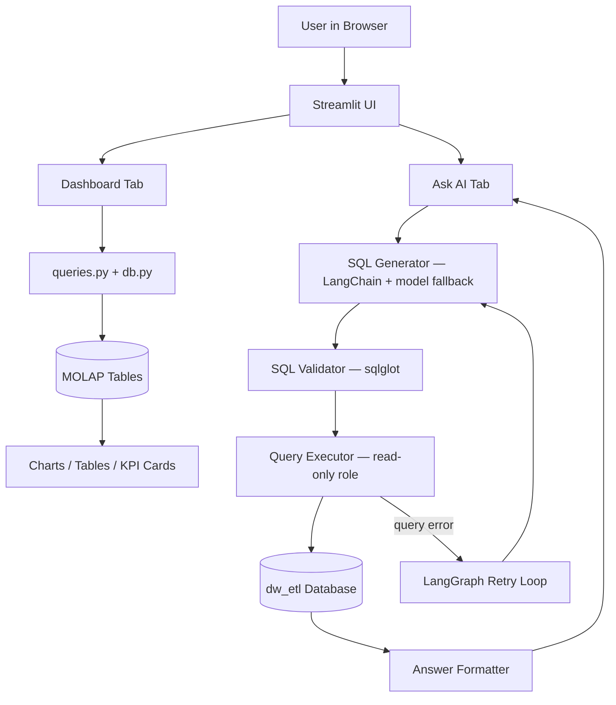

# FinQuery — Financial Analytics Platform

<div align="center">

[](https://www.postgresql.org/)
[](https://www.langchain.com/)
[](https://streamlit.io/)
[](https://smith.langchain.com/)
[](https://www.docker.com/)

**Production-style data warehouse + live analytics dashboard + validated NL-to-SQL agent**

[Architecture](#architecture) • [Data Warehouse](#data-warehouse) • [Application Layer](#application-layer) • [Tech Stack](#tech-stack) • [Project Phases](#project-phases) • [Setup](#setup)

</div>

---

## Overview

FinQuery is a full-stack financial analytics platform built on a PostgreSQL data warehouse. It combines a **live KPI dashboard** backed by precomputed MOLAP tables with a **natural language SQL agent** that answers questions about the warehouse in plain English.

The underlying dataset is the [CaixaBank Tech 2024 AI Hackathon](https://www.kaggle.com/) financial transactions dataset: about 40M transactions covering 2010–2019, with customer demographics, card data, merchant category codes, and fraud labels.

---

## Architecture

### Current Warehouse Flow



### Application Layer



The dashboard and the agent are **separate paths**. The dashboard reads precomputed MOLAP tables with plain SQL and never calls an LLM, so its latency is predictable. The agent path turns a question into SQL, checks it, runs it, and retries with the database error if it fails. A FastAPI layer between the UI and these paths is planned; until it is built, Streamlit calls the functions directly.

---

## Data Warehouse

The warehouse follows a **Kimball star schema**. Data moves through three schemas:

```
staging → etl → dw_etl
```

### Schema

| Table | Type | Description |
|:---|:---|:---|
| `fact_transactions` | Fact | Core transaction grain: amount, fraud label, chip usage, error type |
| `dim_customer` | Dimension | Demographics, income, credit score |
| `dim_card` | Dimension | Card brand, type, limits, expiry |
| `dim_merchant` | Dimension | Merchant identity (chain/brand grain) |
| `dim_location` | Dimension | City, state, zip — conformed, reusable |
| `dim_date` | Dimension | Calendar day with year, quarter, month, day of week, weekend flag |
| `dim_mcc` | Dimension | Merchant category codes and descriptions |
| `dim_error` | Dimension | Transaction error labels (one or several per row) |

Every dimension has an unknown-member row with key `-1`, so facts with unmatched dimensions still load.

> **Note on `dim_merchant` vs `dim_location`:** An audit revealed that `merchant_id` is a brand/chain identifier, not a storefront identifier. 21.6% of merchant IDs span multiple cities, and one spans 2,579. Treating it as a location key silently corrupted all city and state aggregations. The fix was to introduce a separate `dim_location` dimension at the city-state-zip grain, keeping `dim_merchant` as a pure identity table. Full details are in [`WAREHOUSE_REDESIGN_NOTES.md`](SQL/docs/WAREHOUSE_REDESIGN_NOTES.md).

### MOLAP Summary Tables

Five precomputed summary tables power the dashboard:

| Table | Aggregation |
|:---|:---|
| `molap_monthly_transactions` | Monthly volume, total amount, fraud count |
| `molap_top_customers` | Top 10 customers by total spend |
| `molap_fraud_by_state` | Fraud rate per state |
| `molap_card_brand_performance` | Transactions and fraud rate by card brand |
| `molap_transactions_by_city` | Average, min, max spend per city (top 10) |

### Indexing & Partitioning

- **B-Tree indexes** on `date_key`, `customer_key`, `location_key`, `card_key`, `mcc_key` for range scans and join acceleration
- **Partial index** on `fraud_label = TRUE`, compact and fast for fraud-only queries
- **Materialized view** (`mv_monthly_fraud_summary`) with a unique index for concurrent refresh
- **Range partitioning** by year (2010–2019 plus a DEFAULT partition) on a benchmark copy, to validate partition pruning

---

## Application Layer

### Dashboard (built)
- Five Plotly charts read directly from the MOLAP tables through Streamlit
- Monthly transaction trends, top customers, fraud by state, card brand breakdown, city-level spend
- No LLM dependency. Queries are prewritten, fast, and deterministic

### NL-to-SQL Agent (in progress)

Built so far:
- **Schema context:** the warehouse description, query rules, and few-shot examples the model is given. Verified against the real data.
- **SQL generator:** turns a question into SQL, or returns a "cannot answer" reason for questions outside the data (for example, 2024 data, which does not exist). Returns an error result when every model fails.
- **Model fallback:** Gemini is tried first, then Groq, then other Gemini models. Each attempt is logged with timing and token counts.
- **SQL validator:** parses the query with `sqlglot` and accepts only a single SELECT (or WITH/UNION of SELECTs) against `dw_etl` and `molap`. It rejects writes, unqualified or foreign schemas, blocked functions, and out-of-range LIMITs, and adds a LIMIT when none is given.

Planned:
- **Query executor** on the read-only database role, with a statement timeout
- **LangGraph retry loop**: on a database error, the failed query and error go back to the generator. Capped at two retries.
- **LangSmith tracing** of every run: prompts, SQL, retries, latency, and token use
- **Answer formatter**: turns result rows into a plain-English answer
- **Evaluation** on 20–30 question/SQL pairs, measuring accuracy with and without self-correction, and comparing models

LangGraph is used in one place only: the retry loop.

---

## Tech Stack

| Layer | Technology | Status |
|:---|:---|:---|
| **Database** | PostgreSQL 18 (Azure Database for PostgreSQL Flexible Server), star schema, Kimball dimensional modeling | ✅ Built |
| **ETL** | Pure SQL pipeline (`staging → etl → dw_etl`) | ✅ Built |
| **OLAP / MOLAP** | Precomputed summary tables, materialized view, range partitioning | ✅ Built |
| **LLM providers** | Google Gemini (primary), Groq (fallback), via LangChain | 🔧 In progress |
| **Agent orchestration** | LangChain (prompts, model calls), LangGraph (retry loop) | 🔧 In progress |
| **Validation** | `sqlglot`-based SQL validator + read-only database role | ✅ Built |
| **Dashboard** | Streamlit, Plotly, SQLAlchemy | ✅ Built |
| **Backend API** | FastAPI | ⏳ Planned |
| **Observability** | LangSmith (tracing, evaluation, cost tracking) | ⏳ Planned |
| **Deployment** | Docker, cloud hosting, GitHub Actions | ⏳ Planned |

---

## Project Phases

| Phase | Scope | Status |
|:---|:---|:---|
| **1 — Data Warehouse** | Star schema, ETL pipeline, MOLAP tables, indexing, partitioning, read-only role | ✅ Complete |
| **2 — NL-to-SQL Agent** | Schema context ✅, SQL generator ✅, SQL validator ✅, query executor, LangGraph retry loop, LangSmith tracing, answer formatter | 🔧 In progress |
| **3 — API and Ask AI Tab** | FastAPI endpoints for the dashboard and agent, Ask AI tab wired to the agent, MOLAP refresh script | ⏳ Planned |
| **4 — Evaluation and Deployment** | 20–30 question evaluation set, before/after self-correction accuracy, Docker, cloud hosting, CI/CD | ⏳ Planned |
| **5 — Documentation** | Final README and project write-up | ⏳ Planned |

---

## Repository Structure

```text
FinQuery/
├── SQL/
│   ├── 01_schema/
│   │   └── schema.sql                  # Star schema — 7 dimensions + fact table
│   ├── 02_etl/
│   │   └── etl.sql                     # Staging → cleaned → dimensional load
│   ├── 03_molap/
│   │   └── molap_tables.sql            # 5 precomputed KPI summary tables
│   ├── 04_indexing_partitioning/
│   │   └── indexing_partitioning.sql   # Indexes, materialized view, range partitions
│   ├── 05_olap_queries/
│   │   └── olap_queries.sql            # Analytics queries
│   ├── 06_security/
│   │   └── create_readonly_role.sql    # Read-only role (set a password before running)
│   │
│   ├── data_raw/                       # Local-only raw/source data — not pushed to GitHub
│   ├── comparisons/                    # Local-only comparison files — not pushed to GitHub
│   ├── backup/                         # Local-only database/file backups — not pushed to GitHub
│   │
│   └── docs/
│       ├── schema_justification.sql    # Modeling decisions and rationale
│       ├── WAREHOUSE_REDESIGN_NOTES.md # Local-only redesign notes — not pushed to GitHub
│       └── schema_diagram.pdf          # ER diagram
│
├── app/
│   ├── __init__.py                     # Makes app/ an importable package
│   ├── config.py                       # Env var loader (database, Gemini and Groq keys)
│   ├── db.py                           # SQLAlchemy engine, run_query, health_check
│   ├── queries.py                      # Named MOLAP query functions
│   ├── dashboard.py                    # Dashboard tab — 5 Plotly charts
│   ├── ask_ai.py                       # Ask AI tab — still the old demo chain (replaced in Module 3.3)
│   ├── llm_fallback.py                 # Multi-provider fallback (Gemini + Groq), per-attempt logging
│   ├── schema_context.py               # Schema description, query rules, few-shot examples (Module 2.1)
│   ├── sql_generator.py                # Question → SQL, cannot-answer and error results (Module 2.2)
│   ├── sql_validator.py                # Parser-based safety checks, LIMIT enforcement (Module 2.3)
│   └── app.py                          # Thin orchestration — sidebar + tab delegation
│
├── scripts/
│   ├── check_connection.py             # One-off database connectivity check
│   ├── test_sql_generator.py           # Runs sample questions through the generator (uses model calls)
│   ├── test_sql_validator.py           # 40 offline validator tests (no model calls)
│   └── refresh_molap.py                # MOLAP refresh script (planned)
│
├── main.py                             # Root entrypoint — avoids app/ name collision with Streamlit
├── .env                                # NEVER committed — real secrets
├── .env.example                        # Committed — template with empty values
├── requirements.txt                    # Python dependencies (includes sqlglot, langchain-groq)
├── .gitignore
└── README.md
```

### Local-only SQL folders/files

The following are kept locally and excluded through `.gitignore`:

* `SQL/data_raw/`
* `SQL/comparisons/`
* `SQL/backup/`
* `SQL/docs/WAREHOUSE_REDESIGN_NOTES.md`

---

## Setup

### Prerequisites

- PostgreSQL 18
- Python 3.10+
- Docker (for deployment, planned)

### Run the Warehouse

```bash
git clone https://github.com/yourusername/finquery.git
cd finquery

# Load in order — each file depends on the one before it
psql -U postgres -f SQL/01_schema/schema.sql
psql -U postgres -f SQL/02_etl/etl.sql
psql -U postgres -f SQL/03_molap/molap_tables.sql
psql -U postgres -f SQL/04_indexing_partitioning/indexing_partitioning.sql

# Optional: create the read-only role used by the application
# (change the password inside the file first)
psql -U postgres -f SQL/06_security/create_readonly_role.sql

# Verify with OLAP queries
psql -U postgres -f SQL/05_olap_queries/olap_queries.sql
```

### Run the Application

```bash
pip install -r requirements.txt
streamlit run main.py
```

### Environment Variables

Create a `.env` file in the project root. Check `app/config.py` for the exact database variable names.

```env
# Database (read-only role used by the app)
DB_HOST=localhost
DB_PORT=5432
DB_NAME=finquery_dw_ai
DB_USER=finquery_readonly
DB_PASSWORD=your_password

# LLM providers
GOOGLE_API_KEY=your_gemini_api_key
GROQ_API_KEY=your_groq_api_key        # optional fallback provider
```

---

## Data Source

Dataset: [CaixaBank Tech — 2024 AI Hackathon](https://www.kaggle.com/) (Kaggle)
Five files: `transactions_data.csv`, `users_data.csv`, `cards_data.csv`, `mcc_codes.json`, `train_fraud_labels.json`

---

## License

For portfolio and educational use. Dataset credit: CaixaBank Tech, 2024 AI Hackathon.